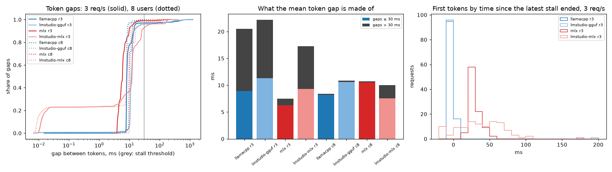

# serve-bench

A load generator and a set of experiments for OpenAI-compatible LLM inference servers.
I wrote it to answer practical serving questions on a laptop-class GPU (Apple M4 Max):
how latency and throughput change as concurrency grows, where goodput collapses under
open-loop load, how much bursty traffic hurts, and what a shared prompt prefix buys.

It measures four servers running the same model, Qwen3-1.7B, with 4-bit weights:

| label | server | weights |
|---|---|---|
| `llamacpp` | llama.cpp `llama-server` 0.8.0 (build 11960) | GGUF Q4_K_M |
| `lmstudio-gguf` | LM Studio server, llama.cpp engine 2.66.0 | same GGUF file |
| `mlx` | `mlx_lm.server` (mlx-lm 0.32.2, mlx 0.32.4) | MLX 4-bit |
| `lmstudio-mlx` | LM Studio server, MLX engine 1.13.1 | same MLX files |

Each server gets the same batch budget: 8 concurrent sequences and 32k tokens of KV cache.
`docs/DESIGN.md` explains this and every other choice.

## What it measures

- **TTFT, TPOT, ITL, E2E** per request, defined as in vLLM's `benchmark_serving`.
  TPOT divides by the server-reported token count, not by the number of SSE chunks.
- **Output throughput** in tokens/s over the whole run.
- **Goodput**: requests per second that meet *both* TTFT ≤ 1 s and TPOT ≤ 50 ms, the
  DistServe definition. The SLO is set per run with `--slo-ttft` and `--slo-tpot`.
- **Load shapes**: closed loop with C users, and open loop with constant, Poisson or
  burst arrivals. All open-loop patterns use the same mean rate.
- **Prompt length** and **shared prefixes**, with the server's `cached_tokens` recorded
  when it reports them.

Every result file also records the machine state before and after the run: load average,
GPU utilization from other apps, free memory, power source and the top CPU users.

## Quick start

```bash
make test        # no model or GPU needed: tests run against a fake server
uv run servebench run --url http://127.0.0.1:8081 --label llamacpp --out out.json \
    --concurrency 8 --n 64 --prompt-tokens 512 --max-tokens 128 --ignore-eos
```

### Reproducing the results

Tools: `brew install llama.cpp`, [uv](https://docs.astral.sh/uv/) and LM Studio with its `lms`
CLI. Model files go in LM Studio's model folder (override with `MODELS=`):

```bash
M=~/.lmstudio/models/lmstudio-community
mkdir -p $M/Qwen3-1.7B-GGUF $M/Qwen3-1.7B-MLX-4bit
curl -L -o $M/Qwen3-1.7B-GGUF/Qwen3-1.7B-Q4_K_M.gguf \
  https://huggingface.co/lmstudio-community/Qwen3-1.7B-GGUF/resolve/main/Qwen3-1.7B-Q4_K_M.gguf
for f in config.json model.safetensors model.safetensors.index.json tokenizer.json \
         tokenizer_config.json special_tokens_map.json added_tokens.json vocab.json merges.txt; do
  curl -L -o $M/Qwen3-1.7B-MLX-4bit/$f \
    https://huggingface.co/lmstudio-community/Qwen3-1.7B-MLX-4bit/resolve/main/$f
done
uv sync --group mlx
make bench       # every server and experiment, then results/SUMMARY.md and docs/img/*.png
```

`scripts/bench.sh <server> [experiment ...]` runs one server, and `ONLY="r8 c4"` limits it to
single points. `REPS="2 3"` adds repeats as `<server>_<x>_rep<N>.json`; the report then plots the
median with a min–max band and lists the spread in `SUMMARY.md`. Before each run it waits until
the 1-minute load average is below 6 and other apps use less than 20% of the GPU.

## Results

All numbers come from the JSON files in `results/`. `results/SUMMARY.md` lists every run with
its load and GPU state, and the plots below are generated from the same files. Times are p50
unless marked otherwise. The concurrency, rate and arrival experiments use ~268-token prompts
and 128 output tokens.

**Caveat on conditions.** The mac was shared with other work, often a Blender render on the GPU.
Each run waited for a quiet moment, but the render sometimes started mid-run. 10 of the 96 result files
began with other apps using more than 15% of the GPU (the `GPU % before` column in
`SUMMARY.md`). Treat differences under ~15% between servers as noise. On Nov 4–5 I repeated
every server's concurrency and rate points twice. Where a point has repeats, the plots draw the median
and a min–max band. The other experiments are still single runs (see "Repeats" below).

### Repeats (Nov 4–5)

Two more passes of the concurrency and rate points (`results/*/llamacpp_*_rep2.json`, `_rep3.json`).
Each run started with other apps under 20% GPU and load under 8. A minute-by-minute log of the day
is in `results/machine/samples-2026-11-04.tsv`. The first column is the Nov 1 run that the tables
below use.

| point | Nov 1 | Nov 4 rep2 | Nov 4 rep3 |
|---|---|---|---|
| 1 user: TTFT ms / tok/s | 84 / 195 | 80 / 208 | 85 / 208 |
| 8 users: tok/s | 629 | 625 | 611 |
| 16 users: tok/s | 590 | 627 | 296 |
| 32 users: tok/s | 546 | 565 | 327 |
| 2 req/s: TPOT ms | 10.5 | 20.6 | 13.2 |
| 3 req/s: goodput / TTFT p50 ms / TPOT ms | 1.21 / 961 / 19.9 | 2.31 / 189 / 18.8 | 2.38 / 136 / 17.1 |
| 4 req/s: goodput | 0.50 | 3.40 | 1.16 |

- **Holds:** single-stream speed, the ~620 tok/s plateau at 8 users, and TPOT of 17–20 ms at
  3 req/s, which is what the stall analysis below explains.
- **Does not hold:** llama.cpp's goodput at 3–4 req/s. Nov 1 gave 1.21 and 0.50 req/s, Nov 4
  gave 2.31–3.40. The `mlx_lm.server` numbers in the rate table (2.56 and 3.00) fall inside that range, so
  "1.7× the best of the others" was a single-run result, and the LM Studio repeats below end it.
- rep3 at 16 and 32 users dropped to ~300 tok/s with TPOT 16.5 ms. The gate only checks before a
  run. While it waited between runs, it read 0–60% GPU use from other apps
  (`results/machine/gate-2026-11-04-llamacpp.log`). I count those two as interference, and they set
  the band at 16–32 users.
- rep2 at 3 req/s overlapped a two-second dry run of my own against the fake server. It is kept as
  measured, and the band includes it.

`mlx_lm.server` got two more passes of the same points (`results/*/mlx_*_rep2.json`, `_rep3.json`).
rep2 ran on Nov 4 afternoon under the old gate. It was stopped from outside at 15:11, while it waited
on the GPU gate (`results/machine/gate-2026-11-04-mlx.log`), so its 8 req/s point ran after rep3, at 00:15 with load 51.
From Nov 4 22:40 the gate checks only GPU (other apps under 20%), not load. rep3 ran 22:55–00:16
with the 1-minute load average at 57–83 before each run (`state_before` in each file;
minute-by-minute in `results/machine/samples-2026-11-04.tsv` and `-11-05.tsv`):

| point | Nov 1 | Nov 4 rep2 | Nov 4–5 rep3 (load 57–83) |
|---|---|---|---|
| 1 user: TTFT ms / tok/s | 97 / 176 | 85 / 221 | 104 / 135 |
| 8 users: tok/s | 538 | 585 | 434 |
| 3 req/s: goodput / TPOT ms | 2.56 / 7.0 | 2.56 / 6.4 | 2.14 / 16.4 |
| 4 req/s: goodput | 3.00 | 2.52 | 0.40 |
| 8 req/s: goodput / TPOT ms | 0.13 / 15.5 | 0.05 / 22.5 | 0.06 / 21.8 |

On a quiet machine, its goodput at 3 req/s repeated exactly, and its low TPOT under open load held.
On Nov 4, at 3 req/s, `mlx_lm.server` beat llama.cpp by ~1.1× (2.56 vs 2.31–2.38), not 1.7×. The
Nov 1 one-user run started with 22% GPU from other apps, which may explain its lower speed.
rep3 was slower at every point: 135 tok/s for one user instead of 176–221, and 16.4 ms TPOT at 3 req/s
instead of 6.4–7.0. Other apps kept the CPU busy (load 57–83 on 16 cores) while the GPU stayed under the
gate, so I read rep3 as what this server does on a CPU-loaded machine, not as noise. That makes the band
at those points wider than the run-to-run spread on a quiet machine.

LM Studio's two engines got two passes each on Nov 5, 00:19–01:34 (`results/*/lmstudio-*_rep2.json`,
`_rep3.json`), with the GPU gate only. Load was 44–69 before the GGUF runs and 32–57 before the MLX runs:

| point | GGUF Nov 1 | GGUF rep2 | GGUF rep3 | MLX Nov 1 | MLX rep2 | MLX rep3 |
|---|---|---|---|---|---|---|
| 1 user: tok/s | 181 | 143 | 126 | 250 | 177 | 181 |
| 8 users: tok/s | 532 | 415 | 427 | 535 | 417 | 409 |
| 3 req/s: goodput / TPOT ms | 1.17 / 21.7 | 2.30 / 17.7 | 2.51 / 15.3 | 1.33 / 19.9 | 2.56 / 7.3 | 2.56 / 9.1 |
| 4 req/s: goodput | 0.18 | 0.64 | 1.18 | 0.24 | 1.25 | 1.75 |

- Closed-loop throughput fell by 20–30% on the CPU-loaded machine, on both engines, as it did for
  `mlx_lm.server`.
- Goodput at 3–4 req/s went the other way: both LM Studio engines roughly doubled their Nov 1 numbers,
  as llama.cpp did on Nov 4. At 3 req/s every server's repeats land at 2.1–2.6 req/s
  (llama.cpp 2.31–2.38, `mlx_lm.server` 2.14–2.56, LM Studio GGUF 2.30–2.51, LM Studio MLX 2.56).
  So the first rate pass is the outlier for three of the four servers, and I can't rank the servers
  at 3 req/s. I don't know what was different then. Those first-pass runs at 3 and 4 req/s
  started with load 3.5–5.9 and 4–15% GPU from other apps (LM Studio MLX's ran on Nov 2).
- LM Studio MLX's TPOT at 3 req/s was 7–9 ms in both repeats, not ~20 ms. The stall analysis below
  uses the Nov 1 runs only, so its LM Studio MLX row rests on one run.

### Concurrency (closed loop)


| users | llamacpp TTFT / TPOT / tok/s | lmstudio-gguf | mlx | lmstudio-mlx |
|---|---|---|---|---|
| 1 | 84 ms / 4.5 ms / 195 | 86 / 4.7 / 181 | 97 / 4.2 / 176 | 114 / 3.1 / 250 |
| 8 | 573 / 8.5 / **629** | 547 / 10.8 / 532 | 553 / 10.0 / 538 | 679 / 9.5 / 535 |
| 16 | 2203 / 9.6 / 590 | 2443 / 10.7 / 528 | 2192 / 16.8 / 464 | 2519 / 9.9 / 528 |
| 32 | 6054 / 9.3 / 546 | 6900 / 11.3 / 472 | 5779 / 15.1 / 520 | 6659 / 9.4 / 510 |

- A single stream decodes at 4.2–4.7 ms/token (210–240 tokens/s) on three servers.
  LM Studio's MLX engine is the fastest at 3.1 ms (~320 tokens/s).
- Throughput rises until all 8 batch slots are full (~530–630 tok/s), then levels off.
  Past 8 users the extra requests only queue: TTFT jumps from ~0.55 s at 8 users to
  2.2–2.5 s at 16, while TPOT barely moves. This is the batch limit showing up as queueing delay.
- The lmstudio-mlx column comes from a re-run on Nov 2. In the first pass on Nov 1
  (commit `c4bff78`), lmstudio-mlx was stuck at ~170 tok/s with 1.4–2.4 s TTFT at 2–8 users.
  The re-run on a quiet machine did not reproduce that. Its 16- and 32-user points matched
  the first pass within 2% (540→528 and 511→510 tok/s). During the first pass, another 27B
  model was resident in the same LM Studio instance. I could not tell whether it was
  generating, so I count the dip as interference, not as a property of the server.

### Goodput under Poisson load


| offered req/s | llamacpp goodput / TTFT p99 | lmstudio-gguf | mlx | lmstudio-mlx |
|---|---|---|---|---|
| 2 | 1.77 / 935 ms | 1.43 / 2301 | 1.73 / 1063 | 1.80 / 664 |
| 3 | 1.21 / 3329 | 1.17 / 3540 | **2.56** / 748 | 1.33 / 2704 |
| 4 | 0.50 / 8880 | 0.18 / 13886 | **3.00** / 1678 | 0.24 / 11940 |
| 6 | 0.12 / 21725 | 0.10 / 48884 | 0.26 / 18274 | 0.11 / 39218 |

- Goodput peaks at 1.4–1.8 req/s for three servers. `mlx_lm.server` keeps going to
  3.0 req/s, about 1.7× the best of the others. That gap did not survive the repeats: on Nov 4–5
  every server reached 2.1–2.6 req/s at 3 req/s offered (see "Repeats").
- Under open-loop load, TPOT on three servers climbs to ~20 ms at 3 req/s (llama.cpp,
  LM Studio GGUF and LM Studio MLX), while `mlx_lm.server` stays at 7 ms (`rate/*_r3.json`).
  In the closed-loop run with 8 users, llama.cpp held 8.5 ms. The next section explains why.
- The lmstudio-mlx rate column was re-run on Nov 2 (load 5.3–5.9, other apps' GPU 0–6%
  at the start of each run). The first-pass numbers from Nov 1 are in commit `c4bff78`.
- Past capacity, every server degrades the same way: the queue grows for the whole run,
  and p99 TTFT reaches tens of seconds.
- Goodput at 1 req/s reads 0.83, not 1.0, because the run's duration includes the tail
  after the last arrival.

### Why TPOT climbs under open load: prefills stall running streams



No new runs here: each result file already holds every chunk's timestamp. A gap above 30 ms
between two tokens of one stream counts as a stall, and overlapping stalls of different streams
count as one. To check whether stalls come from other requests starting, I count the first tokens
that arrive within 100 ms after a stall ends, then repeat the count with the same stalls placed
at random times. Numbers at 3 req/s (`results/SUMMARY.md`, section "stalls"):

| server | TPOT p50 | mean token gap: from gaps ≤ 30 ms + from gaps > 30 ms | stall ms per request | first tokens right after a stall (random placement) |
|---|---|---|---|---|
| `llamacpp` | 19.9 | 8.9 + 11.6 | 259 | 92% (16%) |
| `lmstudio-gguf` | 21.7 | 11.3 + 10.9 | 229 | 93% (20%) |
| `mlx` | 7.0 | 6.3 + 1.2 | 57 | 80% (13%) |
| `lmstudio-mlx` | 19.9 | 9.3 + 8.0 | 257 | 88% (36%) |

- **The hypothesis holds on the llama.cpp servers.** Without stalls, llama.cpp's mean gap at
  3 req/s is 8.9 ms, close to the 8.2 ms of normal gaps at 8 closed-loop users. 92.5% of first tokens on llama.cpp
  and 93% on LM Studio GGUF land within 10 ms of a stall's end. On llama.cpp the stall share of streaming time
  grows with the rate: 7%, 17%, 56% at 1, 2, 3 req/s, as TPOT goes 5.2, 10.5, 19.9 ms.
- **`mlx_lm.server` stalls too, just less.** 74% of its first tokens come 20–50 ms after a stall.
  It loses 57 ms per request, less than its one-user TTFT of 97 ms, and llama.cpp loses 259 ms,
  three times its one-user TTFT of 84 ms. Both merge arrivals (2.1 and 1.7 requests per stall),
  so merging alone does not explain the gap. I have not found the reason. The batch size is not it
  (next bullet).
- **Smaller or larger batches do not change llama.cpp's stalls** (Nov 5, load 16–73, GPU gate only;
  `results/rate/llamacpp-ub128_*`, `-ub2048_*`, `-b128_*`). At 3 req/s each stall lasts 113–149 ms
  and comes about once per request, with `-ub 128`, `-ub 2048` or `-b 128 -ub 128` alike; the default
  repeats give 130–137 ms. Stall ms per request is 97–121 for the variants vs 121–138 for the default
  repeats, inside the band. A ~270-token prompt fits one 512-token batch anyway, and splitting it
  into 128-token pieces did not let decode steps run between them. So the batch-size hypothesis is out.
- **LM Studio MLX is the weakest evidence.** 23% of its gaps are under 1 ms in both closed and
  open loop: it sends tokens in bunches, so a gap is not one decode step. Moving the threshold to
  20 or 50 ms moves its stall share between 63% and 38% (49–57% on llama.cpp). First tokens stay
  above random placement at every threshold, so I read it as the same mechanism with less confidence.
- **Closed loop hides all of this.** With equal output lengths, the 8-user run on llama.cpp
  moves in lockstep: its 32 requests form 4 cohorts of 8 that send together and get first tokens
  together (`concurrency/llamacpp_c8.json`). Prefill starts as the previous cohort finishes, with
  almost nobody left to interrupt (stalls are 2% of streaming time), so it lands in TTFT (573 ms),
  not in TPOT. At 3 req/s arrivals are staggered, and 119 of 120 requests arrive while another
  stream is decoding. Real traffic looks like the second case.

The table rows are single runs from Nov 1 that started with other apps at 4–6.4% GPU. Client timestamps show that
stalls and first tokens coincide, not what the server was doing during a stall.

### Same mean rate (2 req/s), different burstiness


| pattern | llamacpp TTFT p50 / p99 / SLO met | lmstudio-gguf | mlx | lmstudio-mlx |
|---|---|---|---|---|
| constant | 116 / 547 / 100% | 241 / 812 / 100% | 192 / 290 / 100% | 150 / 161 / 100% |
| Poisson | 225 / 1317 / 95% | 241 / 1467 / 92% | 279 / 639 / 100% | 132 / 230 / 100% |
| bursts of 8 | 1617 / 2056 / **12%** | 4239 / 5347 / **0%** | 456 / 692 / 100% | 851 / 905 / 100% |

All servers handle evenly spaced traffic at this rate. When the same traffic arrives in
bursts of 8, the llama.cpp-based servers miss the 1 s TTFT target for most requests. Both
MLX servers keep every request within SLO.

### Prompt length (one user, 64 output tokens)


| prompt tokens | llamacpp TTFT / TPOT | lmstudio-gguf | mlx | lmstudio-mlx |
|---|---|---|---|---|
| 139 | 48 ms / 4.1 ms | 67 / 5.6 | 57 / 3.9 | 86 / 3.1 |
| 1035 | 290 / 4.4 | 295 / 4.6 | 269 / 4.3 | 329 / 3.3 |
| 3595 | 1187 / 5.1 | 1125 / 5.3 | 1027 / 5.0 | 1049 / 3.7 |

TTFT grows linearly with prompt length: prefill runs at ~3.0k tokens/s (llama.cpp) to
~3.5k tokens/s (MLX), counting TTFT as pure prefill. On llama.cpp and mlx, TPOT grows by
~25% from a 139-token to a 3.6k-token context, because attention reads a longer KV cache.

### Second size: Qwen3-4B (Nov 5)

The same concurrency and prompt points with Qwen3-4B (Q4_K_M GGUF, 2.5 GB; MLX 4-bit, 2.3 GB),
run once with `SIZE=4B scripts/bench.sh <server> concurrency prompt`. Results are labelled
`<server>-4b` (`results/concurrency/*-4b_*.json`, `results/prompt/*-4b_*.json`) and drawn dashed.
They ran 02:05–02:44 with the GPU gate only, at load 20–40, so the fair 1.7B comparison is the
CPU-loaded rep3 from "Repeats" (llama.cpp's rep3 ran under load 8). tok/s at 1 and 8 users,
TTFT for a 3595-token prompt:

| server | 1.7B rep3: 1 user / 8 users | 4B: 1 user / 8 users | 4B ÷ 1.7B at 8 users | 3595-token TTFT 1.7B (Nov 1) → 4B |
|---|---|---|---|---|
| `llamacpp` | 208 / 611 | 105 / 287 | 0.47 | 1187 → 3441 ms |
| `lmstudio-gguf` | 126 / 427 | 72 / 254 | 0.59 | 1125 → 3251 |
| `mlx` | 135 / 434 | 96 / 235 | 0.54 | 1027 → 3070 |
| `lmstudio-mlx` | 181 / 409 | 115 / 210 | 0.51 | 1049 → 3490 |

- 4B has 2.4× the parameters and 1.9–2.3× the weight bytes. At 8 users it delivers 0.47–0.59× the
  1.7B throughput, about what reading twice the weights per step predicts.
- Prefill for a long prompt is ~3× slower (~1.0–1.2k tokens/s), a bit more than the parameter ratio.
  The 1.7B prompt runs were on a quiet machine, so part of that is the load.
- The server order at 8 users stays close: llama.cpp is first on both sizes, and the MLX servers
  are within 15% of each other.

### Shared prompt prefix (2060-token prompts, 4 users)


| tokens shared | llamacpp TTFT p50 / p99 (cached) | lmstudio-gguf | mlx | lmstudio-mlx |
|---|---|---|---|---|
| 0 | 1960 / 3026 (7) | 1728 / 2750 | 2239 / 2279 (10) | 2173 / 2698 |
| 1024 | 3219 / 5178 (1001) | 1436 / 3364 | 1104 / 1145 (1034) | 1371 / 1436 |
| 1920 | 270 / 1740 (1748) | 126 / 2707 | 200 / 253 (1930) | 546 / 570 |

- With 93% of the prompt shared, p50 TTFT drops 7–14× on three servers. On LM Studio's MLX
  engine it drops 4×.
- `mlx_lm.server` gets the cleanest result: TTFT falls in proportion to the shared fraction,
  and p99 stays close to p50.
- The llama.cpp-based servers keep a high p99: the first request on each of the 8 slots
  still pays for the full prefill.
- On Nov 1, llama.cpp's half-shared prefix made TTFT *worse* than no sharing (3.2 s vs 2.0 s),
  even though ~1000 tokens per request came from cache. That did not repeat (below).

LM Studio does not report `cached_tokens`.

**The llama.cpp anomaly, re-run (Nov 5, 01:34–03:00).** Two more default passes plus one run per
llama-server flag that could explain it. The same llama.cpp build as Nov 1 (8642541b2), GPU gate only,
load 25–39. Since Nov 4 each request also stores llama-server's own `timings` from the final chunk,
so "server prompt ms" (the server's mean `prompt_ms`) can be set against client TTFT:

| run | s0 TTFT p50 / server prompt ms | s1024 | s1920 |
|---|---|---|---|
| default, Nov 1 | 1960 / – | 3219 / – | 270 / – |
| default, rep2 | 1564 / 1162 | 1233 / 699 | 296 / 336 |
| default, rep3 | 1661 / 1165 | 1212 / 722 | 312 / 262 |
| `--cache-ram 0` | 1457 / 1158 | **772 / 481** | **146 / 172** |
| `--no-kv-unified` | 1432 / 1103 | 1124 / 673 | 263 / 297 |
| `-sps 0` | 1457 / 1105 | 1163 / 683 | 340 / 215 |
| `--cache-reuse 256` | 1472 / 1139 | 1191 / 673 | 348 / 327 |

(`results/prefix/llamacpp*_s*.json`)

- **s1024 slower than s0 did not come back** in any of the 6 runs: s1024 is 19–47% faster than s0.
  Nov 1 had the same cache hits (1001 tokens per request), so the cache worked that day too, and
  the 3.2 s is a one-off I can't explain from the client side.
- **`--cache-ram 0` is the only flag that changed anything.** It turns off llama-server's host-RAM
  prompt cache. Server prompt time at s1024 fell from ~700 to 481 ms, and TTFT at s1920 to half,
  although it reused *fewer* tokens (937 vs 1001 at s1024). So part of the prompt time at default
  settings is cache bookkeeping, not prefill. This is one run, so take it as a lead, not a result.
- Client TTFT minus server prompt time is 290–530 ms at s0 and s1024 on every run: with 4 users,
  a request waits for the other prompts in the same batch.

### Chat endpoint with lognormal lengths (Nov 5)

`scripts/bench.sh <server> chat`: `/v1/chat/completions` with each server's chat template and
Qwen3's thinking off, prompt and output lengths drawn lognormal (σ = 0.6) around 256 and 128
tokens with a fixed seed, so every server gets the same sequence. One run per point, GPU gate only,
load 36–65 (`results/chat/*.json`):

| server | 1 user: TTFT / TPOT / tok/s | 8 users: TTFT / TPOT / tok/s | output tokens: got / asked (8 users) | full-length answers (8 users) |
|---|---|---|---|---|
| `llamacpp` | 78 / 4.5 / 185 | 147 / 15.0 / 441 | 101.9 / 101.9 | 32/32 |
| `lmstudio-gguf` | 108 / 5.7 / 139 | 243 / 18.6 / 324 | 78.6 / 101.9 | 23/32 |
| `mlx` | 89 / 4.4 / 178 | 705 / 13.7 / 308 | 84.4 / 101.9 | 26/32 |
| `lmstudio-mlx` | 112 / 3.3 / 217 | 377 / 17.4 / 325 | 85.8 / 101.9 | 0/32 |

- Only llama-server honours `ignore_eos` on the chat endpoint. The others stop when the model ends
  its answer, and LM Studio MLX always returns one token less than asked. So tok/s here compares
  different amounts of work; TTFT and TPOT are per request and still compare.
- With variable lengths at 8 users, TPOT is 14–19 ms on every server, close to the open-loop
  numbers and well above the 8.5 ms of the equal-length closed loop. Unequal lengths break the
  lockstep cohorts described above, so prefills land on running streams.
- `mlx_lm.server`'s 8-user TTFT (705 ms) is 1.9–4.8× the others'. This is one run at load 36.
- The template adds ~12 tokens (mean prompt 356 vs 343 words plus the nonce at 1 user). LM Studio gets the
  thinking switch as ` /no_think` in the message (see `docs/DESIGN.md`).

## Limitations

- One machine, shared with other work. Three passes of every server's concurrency and rate points,
  one for everything else; a min–max band over three runs, not a confidence interval. The Nov 4–5
  night passes of `mlx_lm.server` and LM Studio ran with load 32–83 (GPU under 20%), so their bands
  mix machine states.
  Before that, the only repeat was lmstudio-mlx at 16 and 32 users on two different days, which
  agreed within 2%.
- Two model sizes, and 4B only as one CPU-loaded pass. The 4-bit quantizations differ slightly between GGUF and MLX
  (~4.9 vs ~4.5 bits/weight), so MLX-vs-llama.cpp results compare engine plus
  quantization. The LM Studio-vs-upstream pairs use identical weight files.
- Prompts are random common words. Most experiments use `/v1/completions` with fixed lengths; only
  the chat experiment uses chat templates and lognormal lengths, and it is one run per point.
- `mlx_lm.server` cannot ignore EOS. All of its runs still produced the full output length
  (`mean_output_tokens` in each file). LM Studio's MLX engine returns 127 of 128 tokens.
- The client is Python (asyncio + httpx). Against the fake server at 1 ms/token, it took in
  56.6k tokens/s from 64 streams, with TPOT p50 1.1 ms vs the 1.0 ms target
  (`results/ceiling/fake_c64.json`). That is ~90× the best throughput measured on a real
  server here, so client overhead does not limit these results. The extra ~0.1 ms per token
  includes the fake server's own `asyncio.sleep` overshoot.

## Layout

```
servebench/bench.py       prompts, arrival schedules, streaming client, run loop, machine state
servebench/metrics.py     per-request metrics, percentiles, goodput
servebench/report.py      results/SUMMARY.md, docs/img/*.png, stall analysis of token gaps
servebench/fakeserver.py  stdlib fake server with a known timing model (for tests)
scripts/bench.sh          start a server, run the experiments, stop it
results/<experiment>/<server>_<x>.json   one file per run: config, machine state, summary, every request
```

Each result file records the commit it ran on (`machine.servebench_commit`). I rewrote history on
Nov 2 to change the commit email and left the raw files untouched, so the hashes they hold no longer
resolve. Each one has the same tree as a current commit: `04af42e` = `16709e6`, `6d51e5c` = `df6c6ea`,
`de02129` = `ece5832`.

## How it was built

The code, tests and this README were written by Claude Code, Anthropic's AI coding agent, working to Midat's problem statement: Midat chose the problem, set the requirements, reviewed the work and accepted it. Every number above comes from the files in this repository and the commands that produced them.
