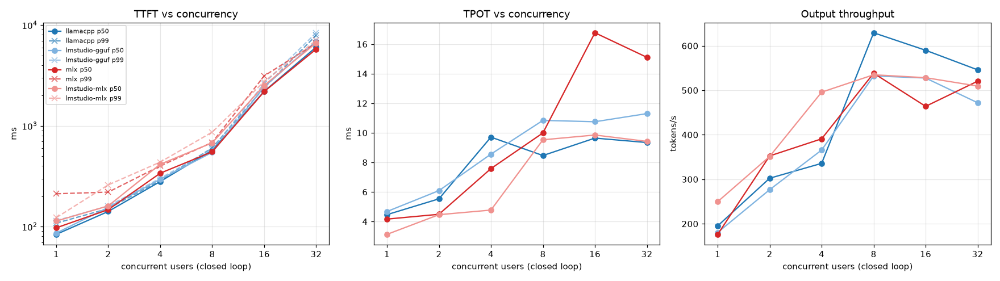
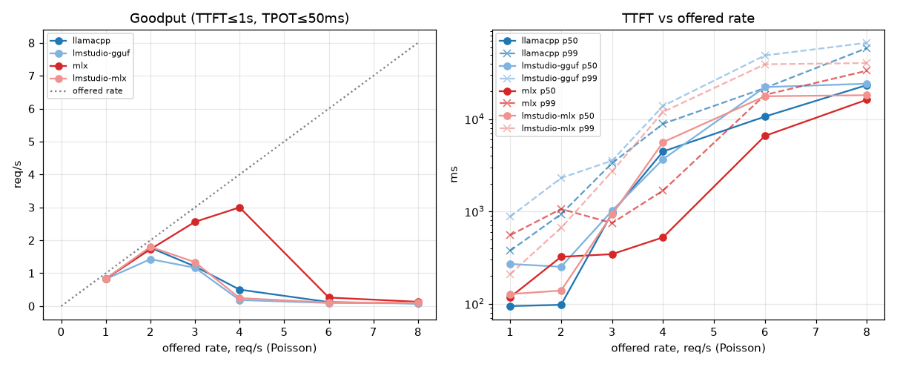
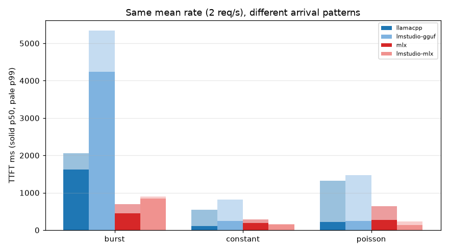
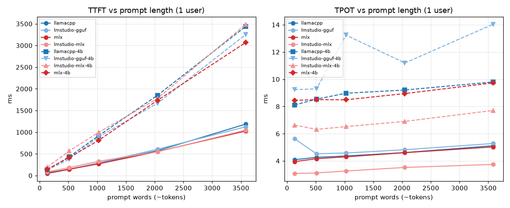
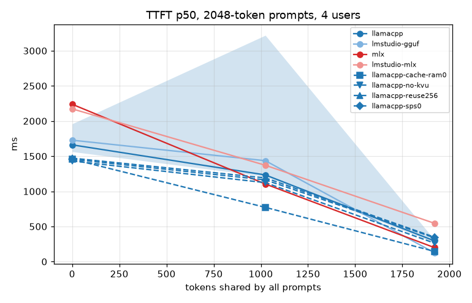

# serve-bench

A load generator and a set of experiments for OpenAI-compatible LLM inference servers.
I wrote it to answer practical serving questions on a laptop-class GPU (Apple M4 Max):
how latency and throughput change as concurrency grows, where goodput collapses under
open-loop load, how much bursty traffic hurts, and what a shared prompt prefix buys.

It measures four servers running the same model, Qwen3-1.7B, with 4-bit weights:

| label | server | weights |
|---|---|---|
| `llamacpp` | llama.cpp `llama-server` 0.8.0 (build 11960) | GGUF Q4_K_M |
| `lmstudio-gguf` | LM Studio server, llama.cpp engine 2.66.0 | same GGUF file |
| `mlx` | `mlx_lm.server` (mlx-lm 0.32.2, mlx 0.32.4) | MLX 4-bit |
| `lmstudio-mlx` | LM Studio server, MLX engine 1.13.1 | same MLX files |

Each server gets the same batch budget: 8 concurrent sequences and 32k tokens of KV cache.
`docs/DESIGN.md` explains this and every other choice.

## What it measures

- **TTFT, TPOT, ITL, E2E** per request, defined as in vLLM's `benchmark_serving`.
  TPOT divides by the server-reported token count, not by the number of SSE chunks.
- **Output throughput** in tokens/s over the whole run.
- **Goodput**: requests per second that meet *both* TTFT ≤ 1 s and TPOT ≤ 50 ms, the
  DistServe definition. The SLO is set per run with `--slo-ttft` and `--slo-tpot`.
- **Load shapes**: closed loop with C users, and open loop with constant, Poisson or
  burst arrivals. All open-loop patterns use the same mean rate.
- **Prompt length** and **shared prefixes**, with the server's `cached_tokens` recorded
  when it reports them.

Every result file also records the machine state before and after the run: load average,
GPU utilization from other apps, free memory, power source and the top CPU users.

## Quick start

```bash
make test        # no model or GPU needed: tests run against a fake server
uv run servebench run --url http://127.0.0.1:8081 --label llamacpp --out out.json \
    --concurrency 8 --n 64 --prompt-tokens 512 --max-tokens 128 --ignore-eos
```

### Reproducing the results

Tools: `brew install llama.cpp`, [uv](https://docs.astral.sh/uv/) and LM Studio with its `lms`
CLI. Model files go in LM Studio's model folder (override with `MODELS=`):

```bash
M=~/.lmstudio/models/lmstudio-community
mkdir -p $M/Qwen3-1.7B-GGUF $M/Qwen3-1.7B-MLX-4bit
curl -L -o $M/Qwen3-1.7B-GGUF/Qwen3-1.7B-Q4_K_M.gguf \
  https://huggingface.co/lmstudio-community/Qwen3-1.7B-GGUF/resolve/main/Qwen3-1.7B-Q4_K_M.gguf
for f in config.json model.safetensors model.safetensors.index.json tokenizer.json \
         tokenizer_config.json special_tokens_map.json added_tokens.json vocab.json merges.txt; do
  curl -L -o $M/Qwen3-1.7B-MLX-4bit/$f \
    https://huggingface.co/lmstudio-community/Qwen3-1.7B-MLX-4bit/resolve/main/$f
done
uv sync --group mlx
make bench       # every server and experiment, then results/SUMMARY.md and docs/img/*.png
```

`scripts/bench.sh <server> [experiment ...]` runs one server, and `ONLY="r8 c4"` limits it to
single points. Before each run it waits until
the 1-minute load average is below 6 and other apps use less than 20% of the GPU.

## Results

All numbers come from the JSON files in `results/`. `results/SUMMARY.md` lists every run with
its load and GPU state, and the plots below are generated from the same files. Times are p50
unless marked otherwise. The concurrency, rate and arrival experiments use ~268-token prompts
and 128 output tokens.

**Caveat on conditions.** The mac was shared with other work, often a Blender render on the GPU.
Each run waited for a quiet moment, but the render sometimes started mid-run. 10 of the 96 result files
began with other apps using more than 15% of the GPU (the `GPU % before` column in
`SUMMARY.md`). Treat differences under ~15% between servers as noise. Every run is a single
pass, with no repeats.

### Concurrency (closed loop)



| users | llamacpp TTFT / TPOT / tok/s | lmstudio-gguf | mlx | lmstudio-mlx |
|---|---|---|---|---|
| 1 | 84 ms / 4.5 ms / 195 | 86 / 4.7 / 181 | 97 / 4.2 / 176 | 114 / 3.1 / 250 |
| 8 | 573 / 8.5 / **629** | 547 / 10.8 / 532 | 553 / 10.0 / 538 | 679 / 9.5 / 535 |
| 16 | 2203 / 9.6 / 590 | 2443 / 10.7 / 528 | 2192 / 16.8 / 464 | 2519 / 9.9 / 528 |
| 32 | 6054 / 9.3 / 546 | 6900 / 11.3 / 472 | 5779 / 15.1 / 520 | 6659 / 9.4 / 510 |

- A single stream decodes at 4.2–4.7 ms/token (210–240 tokens/s) on three servers.
  LM Studio's MLX engine is the fastest at 3.1 ms (~320 tokens/s).
- Throughput rises until all 8 batch slots are full (~530–630 tok/s), then levels off.
  Past 8 users the extra requests only queue: TTFT jumps from ~0.55 s at 8 users to
  2.2–2.5 s at 16, while TPOT barely moves. This is the batch limit showing up as queueing delay.
- The lmstudio-mlx column comes from a re-run on Nov 2. In the first pass on Nov 1
  (commit `1f52487`), lmstudio-mlx was stuck at ~170 tok/s with 1.4–2.4 s TTFT at 2–8 users.
  The re-run on a quiet machine did not reproduce that. Its 16- and 32-user points matched
  the first pass within 2% (540→528 and 511→510 tok/s). During the first pass, another 27B
  model was resident in the same LM Studio instance. I could not tell whether it was
  generating, so I count the dip as interference, not as a property of the server.

### Goodput under Poisson load



| offered req/s | llamacpp goodput / TTFT p99 | lmstudio-gguf | mlx | lmstudio-mlx |
|---|---|---|---|---|
| 2 | 1.77 / 935 ms | 1.43 / 2301 | 1.73 / 1063 | 1.80 / 664 |
| 3 | 1.21 / 3329 | 1.17 / 3540 | **2.56** / 748 | 1.33 / 2704 |
| 4 | 0.50 / 8880 | 0.18 / 13886 | **3.00** / 1678 | 0.24 / 11940 |
| 6 | 0.12 / 21725 | 0.10 / 48884 | 0.26 / 18274 | 0.11 / 39218 |

- Goodput peaks at 1.4–1.8 req/s for three servers. `mlx_lm.server` keeps going to
  3.0 req/s, about 1.7× the best of the others.
- Under open-loop load, TPOT on three servers climbs to ~20 ms at 3 req/s (llama.cpp,
  LM Studio GGUF and LM Studio MLX), while `mlx_lm.server` stays at 7 ms (`rate/*_r3.json`).
  In the closed-loop run with 8 users, llama.cpp held 8.5 ms. My hypothesis: with
  staggered arrivals, prefills of new requests keep landing between decode steps of
  running ones, and `mlx_lm.server` batches prompts differently. I have not verified this
  with a server-side trace.
- The lmstudio-mlx rate column was re-run on Nov 2 (load 5.3–5.9, other apps' GPU 0–6%
  at the start of each run). The first-pass numbers from Nov 1 are in commit `1f52487`.
- Past capacity, every server degrades the same way: the queue grows for the whole run,
  and p99 TTFT reaches tens of seconds.
- Goodput at 1 req/s reads 0.83, not 1.0, because the run's duration includes the tail
  after the last arrival.

### Same mean rate (2 req/s), different burstiness



| pattern | llamacpp TTFT p50 / p99 / SLO met | lmstudio-gguf | mlx | lmstudio-mlx |
|---|---|---|---|---|
| constant | 116 / 547 / 100% | 241 / 812 / 100% | 192 / 290 / 100% | 150 / 161 / 100% |
| Poisson | 225 / 1317 / 95% | 241 / 1467 / 92% | 279 / 639 / 100% | 132 / 230 / 100% |
| bursts of 8 | 1617 / 2056 / **12%** | 4239 / 5347 / **0%** | 456 / 692 / 100% | 851 / 905 / 100% |

All servers handle evenly spaced traffic at this rate. When the same traffic arrives in
bursts of 8, the llama.cpp-based servers miss the 1 s TTFT target for most requests. Both
MLX servers keep every request within SLO.

### Prompt length (one user, 64 output tokens)



| prompt tokens | llamacpp TTFT / TPOT | lmstudio-gguf | mlx | lmstudio-mlx |
|---|---|---|---|---|
| 139 | 48 ms / 4.1 ms | 67 / 5.6 | 57 / 3.9 | 86 / 3.1 |
| 1035 | 290 / 4.4 | 295 / 4.6 | 269 / 4.3 | 329 / 3.3 |
| 3595 | 1187 / 5.1 | 1125 / 5.3 | 1027 / 5.0 | 1049 / 3.7 |

TTFT grows linearly with prompt length: prefill runs at ~3.0k tokens/s (llama.cpp) to
~3.5k tokens/s (MLX), counting TTFT as pure prefill. On llama.cpp and mlx, TPOT grows by
~25% from a 139-token to a 3.6k-token context, because attention reads a longer KV cache.

### Shared prompt prefix (2060-token prompts, 4 users)



| tokens shared | llamacpp TTFT p50 / p99 (cached) | lmstudio-gguf | mlx | lmstudio-mlx |
|---|---|---|---|---|
| 0 | 1960 / 3026 (7) | 1728 / 2750 | 2239 / 2279 (10) | 2173 / 2698 |
| 1024 | 3219 / 5178 (1001) | 1436 / 3364 | 1104 / 1145 (1034) | 1371 / 1436 |
| 1920 | 270 / 1740 (1748) | 126 / 2707 | 200 / 253 (1930) | 546 / 570 |

- With 93% of the prompt shared, p50 TTFT drops 7–14× on three servers. On LM Studio's MLX
  engine it drops 4×.
- `mlx_lm.server` gets the cleanest result: TTFT falls in proportion to the shared fraction,
  and p99 stays close to p50.
- The llama.cpp-based servers keep a high p99: the first request on each of the 8 slots
  still pays for the full prefill.
- On llama.cpp, a half-shared prefix made TTFT *worse* than no sharing (3.2 s vs 2.0 s),
  even though ~1000 tokens per request came from cache. I have not found the cause yet.

LM Studio does not report `cached_tokens`.

## Limitations

- One machine, shared with other work. Single pass per point, no confidence intervals.
  The only repeat so far, lmstudio-mlx at 16 and 32 users on two different days,
  agreed within 2%.
- One model size (1.7B). Its 4-bit quantizations differ slightly between GGUF and MLX
  (~4.9 vs ~4.5 bits/weight), so MLX-vs-llama.cpp results compare engine plus
  quantization. The LM Studio-vs-upstream pairs use identical weight files.
- Prompts are random common words fed to `/v1/completions`. The tests cover neither chat
  templates nor realistic output-length distributions.
- `mlx_lm.server` cannot ignore EOS. All of its runs still produced the full output length
  (`mean_output_tokens` in each file). LM Studio's MLX engine returns 127 of 128 tokens.
- The client is Python (asyncio + httpx). Against the fake server at 1 ms/token, it took in
  56.6k tokens/s from 64 streams, with TPOT p50 1.1 ms vs the 1.0 ms target
  (`results/ceiling/fake_c64.json`). That is ~90× the best throughput measured on a real
  server here, so client overhead does not limit these results. The extra ~0.1 ms per token
  includes the fake server's own `asyncio.sleep` overshoot.

## Layout

```
servebench/bench.py       prompts, arrival schedules, streaming client, run loop, machine state
servebench/metrics.py     per-request metrics, percentiles, goodput
servebench/report.py      results/SUMMARY.md and docs/img/*.png
servebench/fakeserver.py  stdlib fake server with a known timing model (for tests)
scripts/bench.sh          start a server, run the experiments, stop it
results/<experiment>/<server>_<x>.json   one file per run: config, machine state, summary, every request
```
